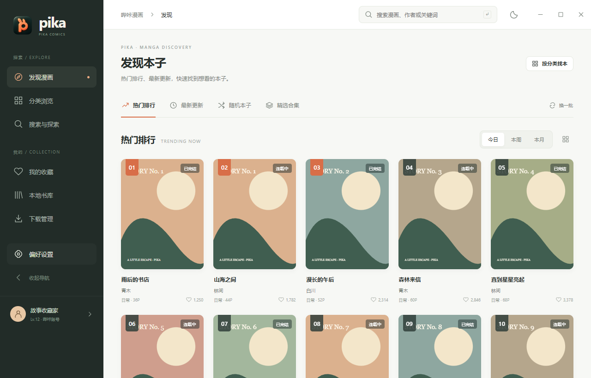
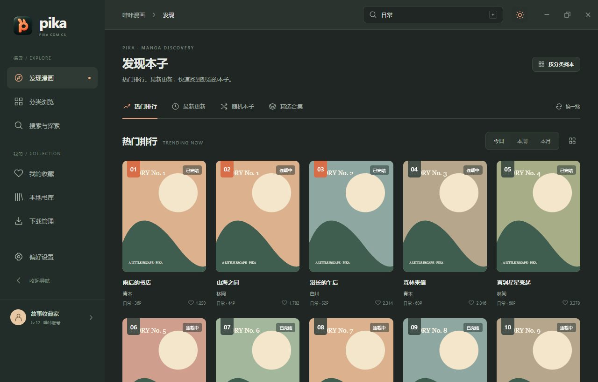
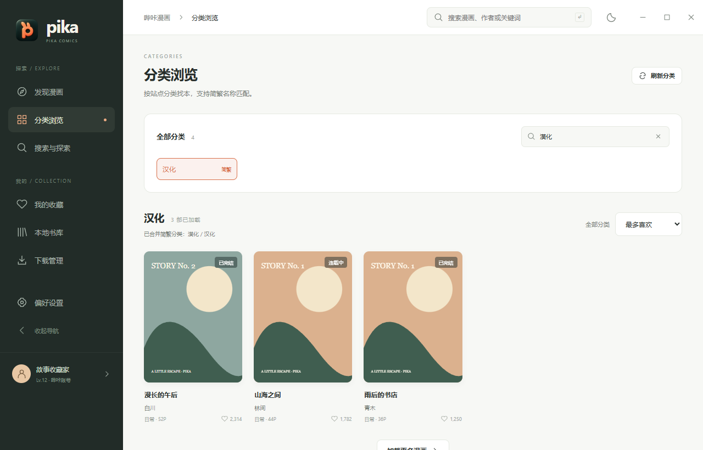
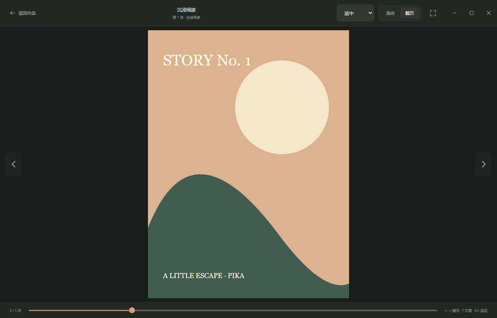
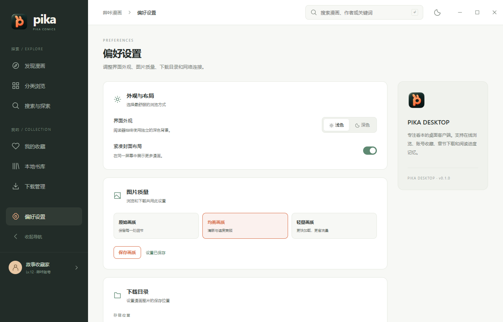

<div align="center">
  
  <h1>Pika Client</h1>
  <p><strong>哔咔漫画桌面客户端</strong></p>
  <p>发现 · 分类 · 收藏 · 阅读 · 下载</p>
  <p>
    <a href="https://v2.tauri.app/"></a>
    <a href="https://vuejs.org/"></a>
    <a href="https://www.typescriptlang.org/"></a>
    <a href="https://www.rust-lang.org/"></a>
    
    
  </p>
  <p>
    <a href="#界面预览">界面预览</a> ·
    <a href="#功能">功能</a> ·
    <a href="#本地开发">本地开发</a> ·
    <a href="#构建安装包">构建安装包</a> ·
    <a href="#常见问题">常见问题</a>
  </p>
</div>

Pika Client 基于 **Tauri 2、Vue 3、TypeScript 和 Rust**，将漫画发现、分类搜索、账号收藏、在线阅读和章节下载整合在一个桌面窗口中。当前以 **Windows** 为主要开发和验证环境。

## 界面预览

下图使用虚构测试数据展示界面，作品名称、封面和用户资料均为演示内容。



<details>
<summary><strong>查看更多界面：深色外观、分类、阅读器与设置</strong></summary>
<br />
<table>
  <tr>
    <td width="50%" align="center"><strong>深色外观</strong><br /><br /></td>
    <td width="50%" align="center"><strong>分类浏览</strong><br /><br /></td>
  </tr>
  <tr>
    <td width="50%" align="center"><strong>在线阅读</strong><br /><br /></td>
    <td width="50%" align="center"><strong>偏好设置</strong><br /><br /></td>
  </tr>
</table>
</details>

## 功能

| 模块           | 已实现                                                                       |
| -------------- | ---------------------------------------------------------------------------- |
| 桌面界面       | 一体化标题栏、拖动与双击最大化、浅色 / 深色主题、可收起导航、紧凑封面布局    |
| 发现漫画       | 24 小时 / 7 天 / 30 天热门排行、最新更新、随机本子、推荐合集                 |
| 搜索           | 漫画名称、作者和关键词搜索，热门搜索词、排序、追加分页                       |
| 分类浏览       | 站点分类列表、简繁同名合并、名称筛选、分类内排序分页、重复作品去重           |
| 作品详情       | 章节目录、收藏、点赞、相关推荐、评论浏览，分类标签直达                       |
| 在线阅读       | 滚动 / 翻页模式、三档阅读宽度、页码跳转、进度记忆、继续阅读、沉浸模式        |
| 下载与本地书库 | 章节下载队列、图片并发下载、自动刷新进度、完成 / 失败状态、本地记录与统计    |
| 设置           | 自定义下载目录、HTTP / SOCKS5 代理、原始 / 均衡 / 轻量画质，外观偏好自动保存；检查更新、下载并安装新版 |

登录状态保存在本机，后续启动会恢复已保存的 token。阅读模式、宽度、进度和界面偏好也会在本地记忆。

## 本地开发

### 环境准备

| 依赖                                                 | 要求                                                                 |
| ---------------------------------------------------- | -------------------------------------------------------------------- |
| [Node.js](https://nodejs.org/en/download)            | 22.12 或更高版本，附带 npm                                           |
| [Rust / Cargo](https://rust-lang.org/tools/install/) | Rust 1.90 或更高版本；Windows 使用 MSVC 工具链                       |
| Windows 构建组件                                     | Microsoft C++ Build Tools，勾选「使用 C++ 的桌面开发」及 Windows SDK |
| WebView2                                             | Microsoft Edge WebView2 Runtime，用于渲染桌面界面                    |

Windows 组件的安装方式见 [Tauri 官方环境准备文档](https://v2.tauri.app/start/prerequisites/#windows)。

### 启动客户端

在项目根目录运行：

```powershell
npm ci
npm run tauri dev
```

首次启动需要编译 Rust 依赖，耗时会比后续启动更长。前端开发服务固定使用 `http://127.0.0.1:1420`。

若只需调试页面样式：

```powershell
npm run dev
```

浏览器预览不包含原生 Tauri 能力；登录、分类请求、下载和数据库操作需要桌面运行环境。自动化界面测试会为这些调用提供隔离的模拟数据。

### 常用命令

| 命令                                                    | 用途                         |
| ------------------------------------------------------- | ---------------------------- |
| `npm run tauri dev`                                     | 启动完整桌面客户端           |
| `npm run dev`                                           | 启动 Vite 前端开发服务       |
| `npm run build`                                         | TypeScript 检查并构建前端    |
| `npm run test:ui`                                       | 运行 Playwright 界面回归测试 |
| `npm run format`                                        | 格式化前端源码和界面测试     |
| `cargo test --manifest-path src-tauri/Cargo.toml --lib` | 运行 Rust 单元测试           |

## 构建安装包

在 Windows 上运行：

```powershell
npm ci
npm run tauri build
```

该命令会先检查并构建前端，再编译 Rust 和生成安装包。输出目录：

```text
src-tauri/target/release/
├── app.exe             # 可执行文件
└── bundle/
    ├── msi/            # Windows MSI 安装包
    └── nsis/           # Windows 安装程序
```

只生成可执行文件、不制作安装包时：

```powershell
npm run tauri build -- --no-bundle
```

仓库中的跨平台图标资源不代表对应平台已经完成适配；macOS、Linux 和移动端尚未列入当前验证范围。

### 检查更新与升级

在「偏好设置 → 软件更新」点击「检查更新」，客户端会读取本仓库 GitHub Releases 的最新正式版本，展示版本号、发布时间和更新说明。检查与安装包下载共用应用内的代理设置；未发布版本、网络错误和请求限流会分别提示，不会误报为已是最新版。

Windows x64 / ARM64 在有匹配的 NSIS 安装包且 GitHub 提供 SHA-256 摘要时，可点击「下载更新」，查看下载进度。下载完成后先校验文件大小与摘要；点击「退出并安装」会再次校验、退出客户端并打开安装向导。若有正在进行或排队的漫画下载，会提示等待下载完成。升级保留现有应用数据；安装完成后重新打开客户端即可。

下载过程中切换页面不会中断更新。校验失败的文件不会执行，可重新检查并下载。没有适配安装包或缺少摘要时，使用「前往发布页」在系统浏览器中手动下载；非 Windows 平台也使用这个入口。更新说明按纯文本展示。

### 发布供客户端检测的新版本

1. 将 `package.json`、`package-lock.json`（包括根包条目）、`src-tauri/tauri.conf.json`、`src-tauri/Cargo.toml` 和 `src-tauri/Cargo.lock` 中的应用版本同步为新的语义化版本，例如 `0.2.0`。
2. 提交并推送代码，再推送对应标签，例如 `v0.2.0`。可先运行 `node scripts/check-release-version.mjs v0.2.0` 检查版本是否一致。
3. `Windows release` 工作流会运行 Rust 测试、构建前端和 Windows x64 NSIS 安装包，并上传到 **Release 草稿**。在 GitHub 补充更新说明、确认附件上传完整后发布草稿。

客户端只检测已发布的正式 Release，不检测草稿或预发布版本；比较语义化版本（例如 `0.10.0` 高于 `0.9.0`），不以标签字符串或提交时间判断升级。GitHub 上传附件时生成的 `sha256:` 摘要用于校验，无需额外配置更新签名密钥。当前工作流生成 Windows x64 安装包；其他架构需另行构建对应安装包。

## 使用与快捷键

1. 使用哔咔账号登录，在「发现漫画」或「分类浏览」中选择作品。
2. 在详情页选择章节，或点击「开始阅读 / 继续阅读」。
3. 需要保存图片时，在章节列表点击下载按钮，到「下载管理」查看进度。
4. 在「本地书库」查看已下载漫画、章节和图片统计；保存路径可在「偏好设置」中修改。

| 操作                           | 效果                                       |
| ------------------------------ | ------------------------------------------ |
| 搜索框内 `Enter`               | 提交关键词搜索                             |
| 阅读器内 `F`                   | 进入 / 退出沉浸模式                        |
| 阅读器内 `Esc`                 | 先退出沉浸模式；普通阅读状态下返回作品详情 |
| 翻页模式下 `←` / `↑`           | 上一页                                     |
| 翻页模式下 `→` / `↓` / `Space` | 下一页                                     |
| 拖动顶部空白区域               | 移动窗口                                   |
| 双击顶部空白区域               | 最大化 / 还原窗口                          |

在输入框或下拉框内操作时，阅读快捷键不会接管输入。

## 配置与本地数据

### 网络与画质

在「偏好设置 → 网络连接」中填写代理地址，例如：

```text
http://127.0.0.1:7890
socks5://127.0.0.1:7891
```

留空并应用后恢复直接连接。代理设置作用于 **Rust 端 API 请求和图片下载**；页面中直接加载的远程图片由 WebView 的网络环境处理。

画质可选择原始、均衡或轻量。它会作为 `image-quality` 配置发送给漫画服务，实际图片效果由服务端返回结果决定。

若首次编译时下载 Rust 依赖较慢，可以单独为 Cargo 配置代理。PowerShell 示例：

```powershell
$env:CARGO_HTTP_PROXY = 'http://127.0.0.1:7890'
npm run tauri dev
```

Cargo 的构建代理与应用内的网络代理分别配置。

### 数据目录

Windows 默认应用数据目录：

```text
%APPDATA%/com.pika.client/
├── pika.db             # 漫画、章节、下载记录和设置，含登录 token
└── downloads/          # 默认下载目录，可在设置中修改
```

下载图片按漫画名和章节名保存，文件名以页码编号。修改下载目录仅影响后续任务，已有文件保留在原位置。

## 验证与测试

```powershell
npm run build
npm run test:ui
cargo test --manifest-path src-tauri/Cargo.toml --lib
```

界面测试使用 Playwright 和本机 **Microsoft Edge**，在独立浏览器会话中模拟 Tauri IPC，不读取真实账号，也不向漫画服务提交收藏、点赞或下载操作。

回归场景包括分类简繁合并、分页去重、排序、请求竞态、搜索追加分页、收藏分页、下载刷新、设置保存、阅读进度、返回路径、一体化窗口按钮，以及 `960 × 640` 最小桌面窗口布局。

运行测试后，界面预览位于 `artifacts/ui/`，失败截图位于 `test-results/`。README 使用的预览图片保存在 `docs/images/`。

## 项目结构

```text
src/
├── components/         # 品牌图标、导航、封面卡片、窗口按钮及状态组件
├── views/              # 发现、分类、搜索、详情、阅读、收藏、下载、书库、设置和登录
├── stores/             # 账号、漫画与分类状态
├── router/             # 页面路由
├── utils/              # 分类归一化、阅读偏好、原生窗口操作
├── style.css           # 全局样式与通用组件
└── styles/pages.css    # 页面布局
src-tauri/
├── src/api/            # API 请求、签名和数据模型
├── src/db/             # SQLite 数据层
├── src/download/       # 章节下载管理
├── src/commands.rs     # Tauri IPC 命令
├── src/category_policy.rs
└── icons/              # Windows 及其他平台图标资源
tests/                  # Playwright 界面测试
docs/images/            # README 界面预览
```

前端通过 Tauri IPC 调用 Rust；Rust 负责网络请求、签名、SQLite 和下载队列，界面由 Vue Router 与 Pinia 管理。

### 图标资源

桌面图标源图为 [`src/assets/pika-desktop-v2.png`](src/assets/pika-desktop-v2.png)，界面品牌图为 [`src/assets/pika-brand.png`](src/assets/pika-brand.png)，Windows 多尺寸图标为 [`src-tauri/icons/icon.ico`](src-tauri/icons/icon.ico)。设计提示词保存在同目录的 `.prompt.txt` 文件中。

重新生成平台图标：

```powershell
npm run tauri icon src/assets/pika-desktop-v2.png
Copy-Item src-tauri/icons/128x128.png src/assets/pika-brand.png
Copy-Item src-tauri/icons/64x64.png public/favicon.png
```

## 常见问题

<details>
<summary><strong>为什么浏览器中打不开完整功能？</strong></summary>

网络请求、账号、数据库和下载通过 Tauri IPC 实现。使用 `npm run tauri dev` 启动桌面客户端；`npm run dev` 主要用于前端样式调试。

</details>

<details>
<summary><strong>本地书库是否支持完全离线阅读？</strong></summary>

本地书库当前提供下载记录、目录内容对应的漫画信息和统计。应用内阅读器仍通过在线接口获取章节图片，尚未接入离线图片读取；已下载图片可直接在保存目录中查看。

</details>

<details>
<summary><strong>下载在退出程序后会继续吗？支持自动续传吗？</strong></summary>

下载运行在客户端进程内，关闭程序后会中断。下次启动会将中断任务标记为失败，目前没有自动续传或暂停 / 恢复按钮。重新提交章节下载时，下载器会跳过保存目录中已存在的图片文件。

</details>

<details>
<summary><strong>分类数量为什么与站点不完全一致？</strong></summary>

客户端会合并简繁同名分类，并跳过停用项、外链推广入口，以及指向未成年人性化内容的分类。合并后按分类原始名称分别请求数据，并对重复作品去重。

</details>

<details>
<summary><strong>开发时提示端口 1420 已被占用怎么办？</strong></summary>

检查是否已有客户端开发进程或 Vite 服务在运行，先关闭重复进程，再重新启动。前端地址与 `src-tauri/tauri.conf.json` 中的 `devUrl` 保持一致。

</details>
